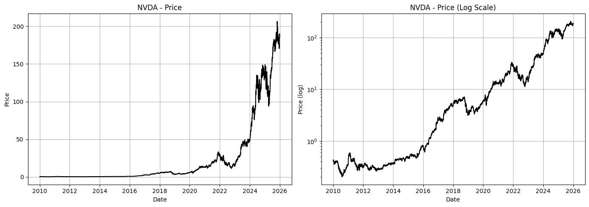
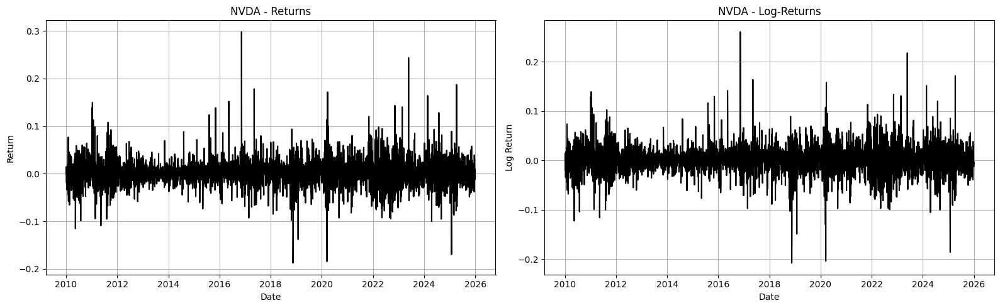
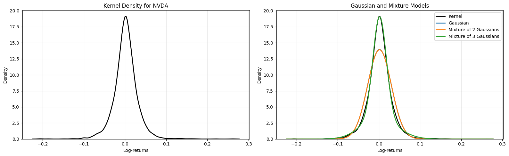
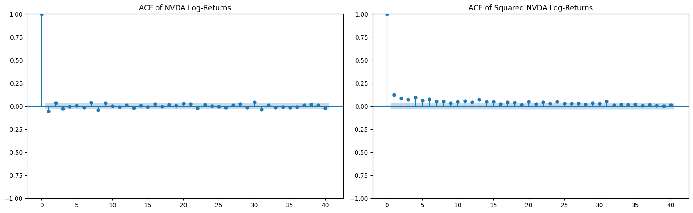
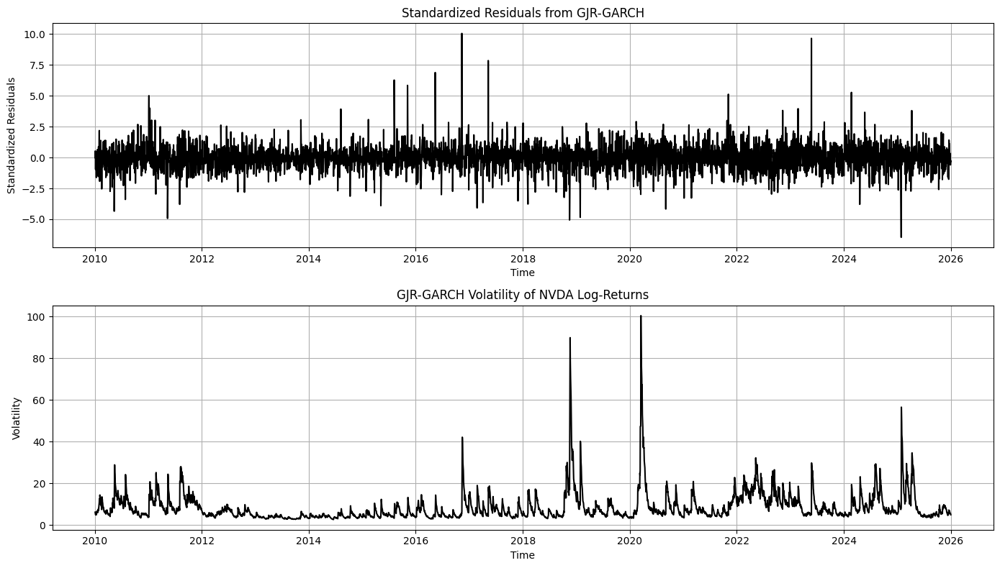
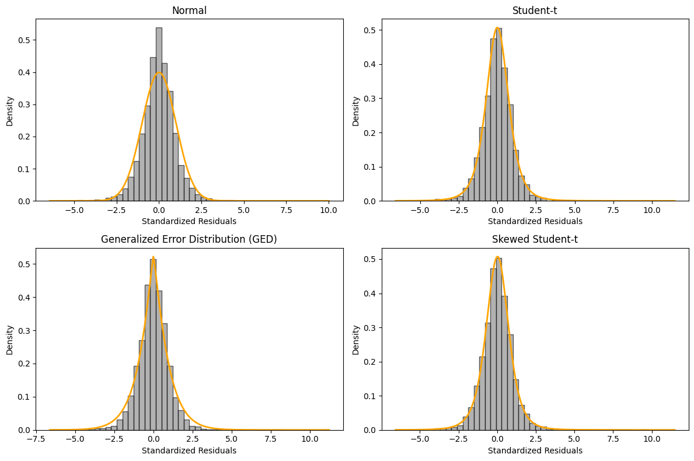

# Portfolio Risk Modelling: GARCH Volatility, DCC Correlations, VaR & Monte Carlo

## Summary

This project develops a two-stage market-risk modelling workflow in Python, progressing from the analysis of a single stock to a multi-asset equity portfolio. The first part focuses on **NVDA**, analysing return distributions, volatility clustering and asymmetric volatility before estimating GARCH-family models and translating the results into one-day VaR measures. The second part extends the framework to an equally weighted portfolio of **NVDA, MSFT, JNJ and PG**, combining individual GARCH models with DCC-GARCH to capture time-varying correlations. Portfolio VaR and Expected Shortfall are then estimated, backtested and complemented with Monte Carlo simulations of future portfolio losses.

## Key Insights

### Part I — Univariate Risk: NVDA

- **Volatility clustering:** squared returns show strong autocorrelation (**Ljung–Box p ≈ 10⁻⁴²**), confirming substantial time dependence in volatility.
- **Fat-tailed returns:** the empirical distribution is clearly non-normal, with a mixture of three Gaussian components providing a better fit than a single Normal distribution.
- **Asymmetric volatility:** the GJR-GARCH(1,1) model identifies a significant leverage effect (**γ ≈ 0.085, p = 0.029**), indicating that negative shocks have a larger impact on volatility.
- **Heavy-tailed innovations:** Student-t innovations outperform Normal innovations (**AIC ≈ 18,719 vs 19,327**).
- **Tail risk:** the **99.9% one-day VaR is ≈ 10.3% under Student-t innovations vs ≈ 6.6% under Normal innovations**, showing the impact of distributional assumptions on extreme-risk estimates.

### Part II — Multivariate Risk: Equity Portfolio

- **Cross-asset risk:** annualised volatility ranges from approximately **17% for JNJ and PG to 45% for NVDA**, while excess kurtosis ranges from **6.9 to 10.6**.
- **GARCH dynamics:** individual GARCH(1,1)-t models remove the volatility dependence from the four return series, with diagnostic p-values **> 0.6**.
- **High persistence:** volatility persistence ranges from approximately **0.94 for PG to 0.996 for NVDA**.
- **Dynamic correlations:** DCC-GARCH estimates **a ≈ 0.011 and b ≈ 0.984**, giving **a + b ≈ 0.995** and indicating highly persistent correlation dynamics.
- **Risk concentration:** NVDA represents **25% of portfolio capital but approximately 58% of portfolio risk**, highlighting the difference between capital allocation and risk contribution.
- **VaR backtesting:** the DCC-Normal model records **192 breaches vs 201 expected at the 95% confidence level**, with a **Kupiec p-value ≈ 0.50**.
- **Forward-looking risk:** Monte Carlo simulations based on the final conditional covariance matrix generate **VaR, Expected Shortfall and multi-day portfolio loss scenarios**.

## 2. Technical Stack

| Area | Tools |
|---|---|
| Language / environment | Python 3, Jupyter Notebook |
| Data acquisition | `yfinance` |
| Data handling | `pandas`, `numpy` |
| Statistical modelling | `arch`, `statsmodels`, `scipy` |
| Machine learning / distributions | `scikit-learn` (`GaussianMixture`) |
| Optimisation | `scipy.optimize` (constrained QMLE for DCC) |
| Visualisation | `matplotlib`, `seaborn` |

### Structure 

Two Jupyter notebooks that build a market-risk workflow in Python, moving from a **single stock (NVDA)** to a **four-asset equity portfolio (NVDA, MSFT, JNJ, PG)**. Daily data runs from January 2010 to December 2025 (4,024 observations).

| Notebook | Scope | Core question |
|---|---|---|
| `Modelling_1.ipynb` | Univariate | How volatile is NVDA, how does that volatility behave over time, and how large can a one-day loss be? |
| `Modelling2_multivariate.ipynb` | Multivariate | How do correlations and volatilities interact at portfolio level, and how reliable is the resulting VaR? |

### Main Analytical Methods

- Log-returns, rolling volatility and distribution analysis
- ACF, Ljung-Box and ARCH-LM diagnostics
- GARCH / GJR-GARCH with AIC/BIC model selection
- Normal, Student-t, GED and Skewed-t innovation distributions
- **DCC-GARCH implemented from scratch**
- Parametric and simulated **VaR / Expected Shortfall**
- **Kupiec** VaR backtesting
- Monte Carlo simulation with Cholesky-correlated shocks

## Part I — Univariate Risk: NVDA

### Data Download

Historical daily price data for NVIDIA (NVDA) was retrieved using `yfinance`, covering the period from January 2010 to December 2025. The dataset includes adjusted closing prices, daily highs and lows, opening prices, and trading volume.

The data was used to calculate daily log-returns and analyze the evolution of NVIDIA's market price and volatility over time.

| Date | Close | High | Low | Open | Volume |
|---|---:|---:|---:|---:|---:|
| 2025-12-24 | 188.169678 | 188.468980 | 186.154389 | 187.501244 | 65,528,500 |
| 2025-12-26 | 190.085205 | 192.240166 | 187.561113 | 189.476629 | 139,740,300 |
| 2025-12-29 | 187.780594 | 188.319327 | 185.475989 | 187.271790 | 120,006,100 |
| 2025-12-30 | 187.102188 | 188.548815 | 186.493612 | 187.800566 | 97,687,300 |
| 2025-12-31 | 186.064606 | 190.115125 | 186.054635 | 189.127446 | 120,100,500 |

### Returns and Log-Returns

Daily simple returns and log-returns were calculated from adjusted closing prices to analyze NVIDIA's daily performance. These measures help characterize the distribution of returns, identify extreme market movements, and assess the statistical properties of the series.

| Statistic | Price | Return | Log Return |
|---|---:|---:|---:|
| Mean | 22.61 | 0.00193 | 0.00151 |
| Std. Dev. | 43.89 | 0.02879 | 0.02861 |
| Minimum | 0.20 | -0.18756 | -0.20771 |
| Median | 3.97 | 0.00178 | 0.00174 |
| Maximum | 206.55 | 0.29807 | 0.26088 |

Daily log returns have a mean of approximately **0.15%** and a standard deviation of **2.86%**, with observed daily losses and gains reaching approximately **-20.8% and +26.1%**, respectively.

### Kernel Density Estimation (KDE)

Kernel Density Estimation (KDE) was used to visualize the empirical distribution of NVIDIA's daily log-returns. This non-parametric approach helps assess the distribution's shape, including its concentration around zero, asymmetry, and potential heavy tails. The empirical distribution of NVIDIA's daily log-returns was compared with a normal distribution and Gaussian Mixture Models (GMMs) with two and three components. This comparison evaluates whether mixtures of Gaussian distributions can better capture the characteristics of financial returns, including asymmetry, heavy tails, and potential heterogeneity in market conditions.

The log-returns of NVDA are highly concentrated around zero and exhibit a pronounced peak with relatively heavy tails. The single Gaussian distribution does not fully capture the empirical shape of the returns. Mixture models provide a more flexible representation, with the three-Gaussian mixture appearing to fit the kernel density particularly well. This suggests that NVDA returns may exhibit non-normal and potentially heterogeneous behavior that is better captured by a mixture distribution.

### Autocorrelation Analysis

The Autocorrelation Function (ACF) was examined for both daily log-returns and squared log-returns. The former helps identify serial dependence in returns, while the latter helps detect volatility clustering and persistence, common characteristics of financial time series.

The ACF of the log-returns shows little evidence of significant autocorrelation, suggesting that returns are approximately uncorrelated over time. In contrast, the squared log-returns exhibit significant positive autocorrelation, indicating volatility clustering: periods of high (or low) volatility tend to be followed by periods of similarly high (or low) volatility. This is a common feature of financial returns and provides motivation for using GARCH-type models.

### GJR-GARCH Model Fitting

A GJR-GARCH(1,1) model was fitted to NVIDIA's daily log-returns to capture volatility clustering and asymmetric responses to market shocks. The model allows negative shocks to have a different impact on conditional volatility than positive shocks of the same magnitude.
For the asset, returns are modeled as:

$$
r_t = \mu + \varepsilon_t,
\qquad
\varepsilon_t = \sigma_t z_t,
\qquad
z_t \sim \mathcal{N}(0,1)
$$

The conditional variance follows a GJR-GARCH(1,1) specification:

$$
\sigma_t^2 =
\omega
+
\left(
\alpha +
\gamma \mathbb{1}_{\{\varepsilon_{t-1}<0\}}
\right)
\varepsilon_{t-1}^2
+
\beta \sigma_{t-1}^2
$$

where:

- $\omega > 0$ is the long-run variance intercept.
- $\alpha$ captures the impact of past shocks on current volatility.
- $\gamma$ captures the **asymmetric effect** of negative shocks.
- $\beta$ measures **volatility persistence**.
- $\mathbb{1}_{\{\varepsilon_{t-1}<0\}}$ is an indicator equal to 1 when the previous shock is negative and 0 otherwise.

A negative shock therefore has an impact of $(\alpha+\gamma)$, while a positive shock has an impact of $\alpha$. A statistically significant $\gamma$ indicates that negative returns generate a stronger volatility response than positive returns of the same magnitude.

### NVDA Results

The GJR-GARCH(1,1) model was estimated using 4,024 daily observations under a Normal innovation distribution.

| Parameter | Estimate | p-value |
|---|---:|---:|
| $\mu$ | 0.1725 | < 0.001 |
| $\omega$ | 0.3206 | 0.067 |
| $\alpha$ | 0.0537 | 0.061 |
| $\gamma$ | 0.0852 | 0.029 |
| $\beta$ | 0.8701 | < 0.001 |

The model achieves:

| Log-Likelihood | AIC | BIC |
|---:|---:|---:|
| -9,644.24 | 19,298.5 | 19,330.0 |

### Interpretation

The estimated $\gamma=0.0852$ is statistically significant at the 5% level, providing evidence of an **asymmetric volatility response**. Negative shocks therefore have a larger effect on future volatility than positive shocks of the same magnitude.

Volatility is also highly persistent, with $\beta=0.8701$. Under the usual approximation for GJR-GARCH with symmetric innovations, the persistence can be expressed as:

$$
P \approx \alpha + \beta + \frac{\gamma}{2}
$$

giving:

$$
P \approx 0.0537 + 0.8701 + \frac{0.0852}{2}
\approx 0.9664
$$

This indicates that volatility shocks in NVDA decay slowly over time, consistent with strong volatility clustering.

### Conditional Volatility Analysis

The fitted GJR-GARCH model was used to estimate NVIDIA's time-varying conditional volatility. The resulting series captures periods of increased and decreased market uncertainty, highlighting volatility clustering and the persistence of volatility over time.

### Innovation Distribution Comparison

To account for the heavy tails observed in the standardized residuals, the GJR-GARCH model was estimated under four different innovation distributions.

| Distribution | Log-Likelihood | AIC | BIC |
|---|---:|---:|---:|
| **Student-t** | **-9,354.30** | **18,718.61** | **18,750.11** |
| Skewed Student-t | -9,353.98 | 18,719.97 | 18,757.77 |
| GED | -9,399.78 | 18,809.56 | 18,841.06 |
| Normal | -9,659.30 | 19,326.60 | 19,351.80 |

The heavy-tailed specifications provide a substantially better fit than the Normal distribution. The **Student-t model is selected as the preferred specification**, achieving the lowest AIC and BIC, while the Skewed Student-t provides a very similar log-likelihood at the cost of an additional parameter.

The results support the presence of **heavy-tailed return innovations**, making the Student-t specification more appropriate for subsequent volatility and risk analysis.

