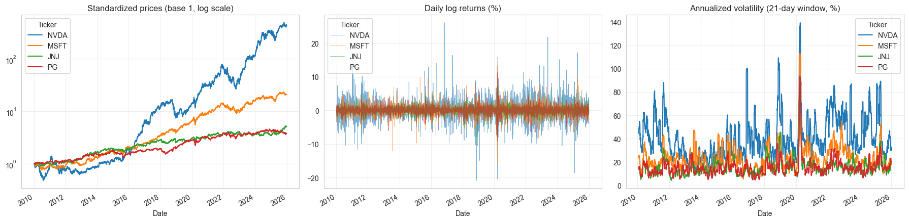
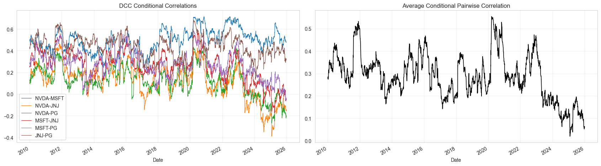
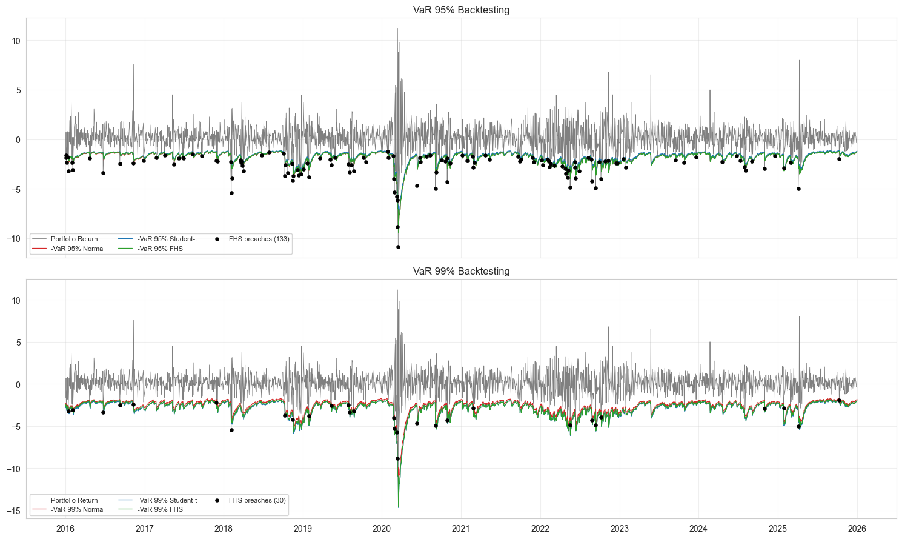
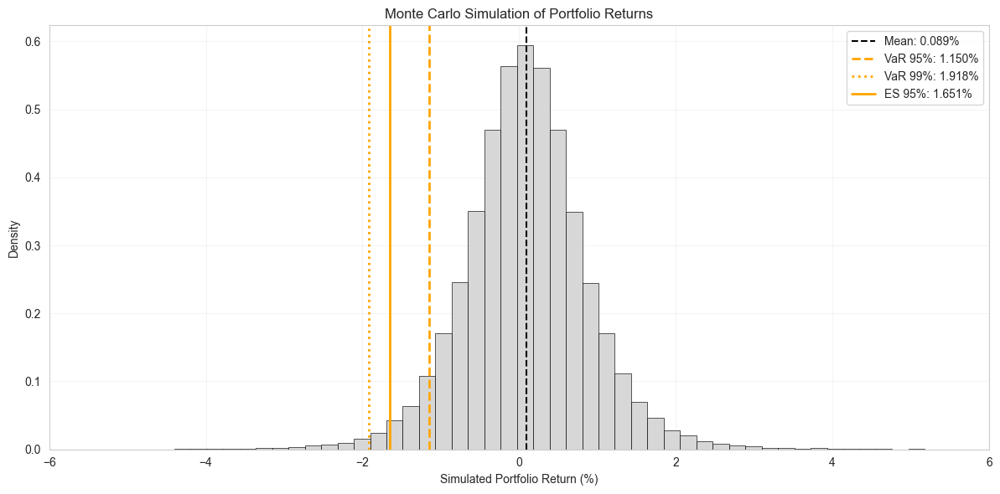
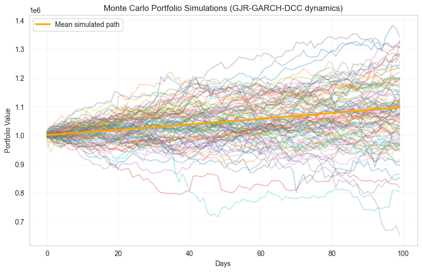

# Portfolio Risk Modelling: GJR-GARCH Volatility, DCC Correlations, VaR & Monte Carlo

# Summary

This project develops a two-stage market-risk modelling workflow in Python, progressing from the analysis of a single stock to a multi-asset equity portfolio. The first part focuses on **NVDA**, analysing return distributions, volatility clustering and asymmetric volatility before estimating GARCH-family models and translating the results into one-day VaR measures. The second part extends the framework to an equally weighted portfolio of **NVDA, MSFT, JNJ and PG**, combining individual GARCH models with DCC-GARCH to capture time-varying correlations. Portfolio VaR and Expected Shortfall are then estimated, backtested and complemented with Monte Carlo simulations of future portfolio losses.

## Structure 

Two Jupyter notebooks that build a market-risk workflow in Python, moving from a **single stock (NVDA)** to a **four-asset equity portfolio (NVDA, MSFT, JNJ, PG)**. Daily data runs from January 2010 to December 2025 (4,024 observations).

| Notebook | Scope | Core question |
|---|---|---|
| `Modelling_1.ipynb` | Univariate | How volatile is NVDA, how does that volatility behave over time, and how large can a one-day loss be? |
| `Modelling2_multivariate.ipynb` | Multivariate | How do correlations and volatilities interact at portfolio level, and how reliable is the resulting VaR? |

## Key Insights

### Part I — Univariate Risk: NVDA

- **Volatility clustering:** squared returns show strong autocorrelation (**Ljung–Box p ≈ 10⁻⁴²**), confirming substantial time dependence in volatility.
- **Fat-tailed returns:** the empirical distribution is clearly non-normal, with a mixture of three Gaussian components providing a better fit than a single Normal distribution.
- **Asymmetric volatility:** the GJR-GARCH(1,1) model identifies a significant leverage effect (**γ ≈ 0.085, p = 0.029**), indicating that negative shocks have a larger impact on volatility.
- **Heavy-tailed innovations:** Student-t innovations outperform Normal innovations (**AIC ≈ 18,719 vs 19,327**).
- **Tail risk:** the **99.9% one-day VaR is ≈ 10.3% under Student-t innovations vs ≈ 6.6% under Normal innovations**, showing the impact of distributional assumptions on extreme-risk estimates.

### Part II — Multivariate Risk: Equity Portfolio

- **Cross-asset risk:** annualised volatility ranges from approximately **17% for JNJ and PG to 45% for NVDA**, while excess kurtosis ranges from **6.9 to 10.6**.
- **GARCH dynamics:** individual GARCH(1,1)-t models remove the volatility dependence from the four return series, with diagnostic p-values **> 0.6**.
- **High persistence:** volatility persistence ranges from approximately **0.94 for PG to 0.996 for NVDA**.
- **Dynamic correlations:** DCC-GARCH estimates **a ≈ 0.011 and b ≈ 0.984**, giving **a + b ≈ 0.995** and indicating highly persistent correlation dynamics.
- **Risk concentration:** NVDA represents **25% of portfolio capital but approximately 58% of portfolio risk**, highlighting the difference between capital allocation and risk contribution.
- **VaR backtesting:** the DCC-Normal model records **192 breaches vs 201 expected at the 95% confidence level**, with a **Kupiec p-value ≈ 0.50**.
- **Forward-looking risk:** Monte Carlo simulations based on the final conditional covariance matrix generate **VaR, Expected Shortfall and multi-day portfolio loss scenarios**.

## Technical Stack

| Area | Tools |
|---|---|
| Language / environment | Python 3, Jupyter Notebook |
| Data acquisition | `yfinance` |
| Data handling | `pandas`, `numpy` |
| Statistical modelling | `arch`, `statsmodels`, `scipy` |
| Machine learning / distributions | `scikit-learn` (`GaussianMixture`) |
| Optimisation | `scipy.optimize` (constrained QMLE for DCC) |
| Visualisation | `matplotlib`, `seaborn` |

### Main Analytical Methods

- Log-returns, rolling volatility and distribution analysis
- ACF, Ljung-Box and ARCH-LM diagnostics
- GARCH / GJR-GARCH with AIC/BIC model selection
- Normal, Student-t, GED and Skewed-t innovation distributions
- **DCC-GARCH implemented from scratch**
- Parametric and simulated **VaR / Expected Shortfall**
- **Kupiec** VaR backtesting
- Monte Carlo simulation with Cholesky-correlated shocks

# Part I — Univariate Risk: NVDA

## Data Download

Historical daily price data for NVIDIA (NVDA) was retrieved using `yfinance`, covering the period from January 2010 to December 2025. The dataset includes adjusted closing prices, daily highs and lows, opening prices, and trading volume.

The data was used to calculate daily log-returns and analyze the evolution of NVIDIA's market price and volatility over time.

| Date | Close | High | Low | Open | Volume |
|---|---:|---:|---:|---:|---:|
| 2025-12-24 | 188.169678 | 188.468980 | 186.154389 | 187.501244 | 65,528,500 |
| 2025-12-26 | 190.085205 | 192.240166 | 187.561113 | 189.476629 | 139,740,300 |
| 2025-12-29 | 187.780594 | 188.319327 | 185.475989 | 187.271790 | 120,006,100 |
| 2025-12-30 | 187.102188 | 188.548815 | 186.493612 | 187.800566 | 97,687,300 |
| 2025-12-31 | 186.064606 | 190.115125 | 186.054635 | 189.127446 | 120,100,500 |

## Returns and Log-Returns

Daily simple returns and log-returns were calculated from adjusted closing prices to analyze NVIDIA's daily performance. These measures help characterize the distribution of returns, identify extreme market movements, and assess the statistical properties of the series.

| Statistic | Price | Return | Log Return |
|---|---:|---:|---:|
| Mean | 22.61 | 0.00193 | 0.00151 |
| Std. Dev. | 43.89 | 0.02879 | 0.02861 |
| Minimum | 0.20 | -0.18756 | -0.20771 |
| Median | 3.97 | 0.00178 | 0.00174 |
| Maximum | 206.55 | 0.29807 | 0.26088 |

Daily log returns have a mean of approximately **0.15%** and a standard deviation of **2.86%**, with observed daily losses and gains reaching approximately **-20.8% and +26.1%**, respectively.

## Kernel Density Estimation (KDE)

Kernel Density Estimation (KDE) was used to visualize the empirical distribution of NVIDIA's daily log-returns. This non-parametric approach helps assess the distribution's shape, including its concentration around zero, asymmetry, and potential heavy tails. The empirical distribution of NVIDIA's daily log-returns was compared with a normal distribution and Gaussian Mixture Models (GMMs) with two and three components. This comparison evaluates whether mixtures of Gaussian distributions can better capture the characteristics of financial returns, including asymmetry, heavy tails, and potential heterogeneity in market conditions.

The log-returns of NVDA are highly concentrated around zero and exhibit a pronounced peak with relatively heavy tails. The single Gaussian distribution does not fully capture the empirical shape of the returns. Mixture models provide a more flexible representation, with the three-Gaussian mixture appearing to fit the kernel density particularly well. This suggests that NVDA returns may exhibit non-normal and potentially heterogeneous behavior that is better captured by a mixture distribution.

## Autocorrelation Analysis

The Autocorrelation Function (ACF) was examined for both daily log-returns and squared log-returns. The former helps identify serial dependence in returns, while the latter helps detect volatility clustering and persistence, common characteristics of financial time series.

The ACF of the log-returns shows little evidence of significant autocorrelation, suggesting that returns are approximately uncorrelated over time. In contrast, the squared log-returns exhibit significant positive autocorrelation, indicating volatility clustering: periods of high (or low) volatility tend to be followed by periods of similarly high (or low) volatility. This is a common feature of financial returns and provides motivation for using GARCH-type models.

## GJR-GARCH Model Fitting

A GJR-GARCH(1,1) model was fitted to NVIDIA's daily log-returns to capture volatility clustering and asymmetric responses to market shocks. The model allows negative shocks to have a different impact on conditional volatility than positive shocks of the same magnitude.
For the asset, returns are modeled as:

$$
r_t = \mu + \varepsilon_t,
\qquad
\varepsilon_t = \sigma_t z_t,
\qquad
z_t \sim \mathcal{N}(0,1)
$$

The conditional variance follows a GJR-GARCH(1,1) specification:

$$
\sigma_t^2 =
\omega
+
\left(
\alpha +
\gamma \mathbb{1}_{\{\varepsilon_{t-1}<0\}}
\right)
\varepsilon_{t-1}^2
+
\beta \sigma_{t-1}^2
$$

where:

- $\omega > 0$ is the long-run variance intercept.
- $\alpha$ captures the impact of past shocks on current volatility.
- $\gamma$ captures the **asymmetric effect** of negative shocks.
- $\beta$ measures **volatility persistence**.
- $\mathbb{1}_{\{\varepsilon_{t-1}<0\}}$ is an indicator equal to 1 when the previous shock is negative and 0 otherwise.

A negative shock therefore has an impact of $(\alpha+\gamma)$, while a positive shock has an impact of $\alpha$. A statistically significant $\gamma$ indicates that negative returns generate a stronger volatility response than positive returns of the same magnitude.

## NVDA Results

The GJR-GARCH(1,1) model was estimated using 4,024 daily observations under a Normal innovation distribution.

| Parameter | Estimate | p-value |
|---|---:|---:|
| $\mu$ | 0.1725 | < 0.001 |
| $\omega$ | 0.3206 | 0.067 |
| $\alpha$ | 0.0537 | 0.061 |
| $\gamma$ | 0.0852 | 0.029 |
| $\beta$ | 0.8701 | < 0.001 |

The model achieves:

| Log-Likelihood | AIC | BIC |
|---:|---:|---:|
| -9,644.24 | 19,298.5 | 19,330.0 |

## Interpretation

The estimated $\gamma=0.0852$ is statistically significant at the 5% level, providing evidence of an **asymmetric volatility response**. Negative shocks therefore have a larger effect on future volatility than positive shocks of the same magnitude.

Volatility is also highly persistent, with $\beta=0.8701$. Under the usual approximation for GJR-GARCH with symmetric innovations, the persistence can be expressed as:

$$
P \approx \alpha + \beta + \frac{\gamma}{2}
$$

giving:

$$
P \approx 0.0537 + 0.8701 + \frac{0.0852}{2}
\approx 0.9664
$$

This indicates that volatility shocks in NVDA decay slowly over time, consistent with strong volatility clustering.

## Conditional Volatility Analysis

The fitted GJR-GARCH model was used to estimate NVIDIA's time-varying conditional volatility. The resulting series captures periods of increased and decreased market uncertainty, highlighting volatility clustering and the persistence of volatility over time.

## Innovation Distribution Comparison

To account for the heavy tails observed in the standardized residuals, the GJR-GARCH model was estimated under four different innovation distributions.

| Distribution | Log-Likelihood | AIC | BIC |
|---|---:|---:|---:|
| **Student-t** | **-9,354.30** | **18,718.61** | **18,750.11** |
| Skewed Student-t | -9,353.98 | 18,719.97 | 18,757.77 |
| GED | -9,399.78 | 18,809.56 | 18,841.06 |
| Normal | -9,659.30 | 19,326.60 | 19,351.80 |

The heavy-tailed specifications provide a substantially better fit than the Normal distribution. The **Student-t model is selected as the preferred specification**, achieving the lowest AIC and BIC, while the Skewed Student-t provides a very similar log-likelihood at the cost of an additional parameter.

The results support the presence of **heavy-tailed return innovations**, making the Student-t specification more appropriate for subsequent volatility and risk analysis.

## Value at Risk (VaR)

VaR is estimated at 5%, 1%, and 0.1% confidence levels under four alternative innovation distributions: Normal, Student-t, GED, and Skewed Student-t. This comparison evaluates how distributional assumptions affect estimated potential losses, particularly under extreme market conditions.

| Distribution | Confidence Level | Expected Return | Volatility | VaR | VaR Loss (%) |
|---|---:|---:|---:|---:|---:|
| Normal | 5.0% | 0.1981 | 0.1981 | 2.1855 | 3.40% |
| Normal | 1.0% | 0.1981 | 0.1981 | 2.1855 | 4.89% |
| Normal | 0.1% | 0.1981 | 0.1981 | 2.1855 | 6.56% |
| Student-t | 5.0% | 0.1533 | 0.1533 | 2.1769 | 3.20% |
| Student-t | 1.0% | 0.1533 | 0.1533 | 2.1769 | 5.57% |
| Student-t | 0.1% | 0.1533 | 0.1533 | 2.1769 | **10.28%** |
| GED | 5.0% | 0.1657 | 0.1657 | 2.1590 | 3.38% |
| GED | 1.0% | 0.1657 | 0.1657 | 2.1590 | 5.61% |
| GED | 0.1% | 0.1657 | 0.1657 | 2.1590 | 8.62% |
| Skewed Student-t | 5.0% | 0.1406 | 0.1406 | 2.1771 | 3.24% |
| Skewed Student-t | 1.0% | 0.1406 | 0.1406 | 2.1771 | 5.66% |
| Skewed Student-t | 0.1% | 0.1406 | 0.1406 | 2.1771 | **10.47%** |

The results highlight the importance of the assumed return distribution, particularly at extreme confidence levels. At 5%, the estimated losses are relatively similar across distributions, but the differences become substantial at the **0.1% tail**. The Student-t and Skewed Student-t specifications produce VaR losses above 10%, reflecting their ability to capture the heavy tails observed in NVDA returns. This supports the use of **heavy-tailed distributions for extreme-risk estimation** rather than relying solely on the Normal assumption.

# Part II — Multivariate Portfolio Risk Analysis

This section analyses a four-asset portfolio consisting of NVIDIA (NVDA), Microsoft (MSFT), Johnson & Johnson (JNJ), and Procter & Gamble (PG). The objective is to model time-varying volatility and correlations, estimate portfolio risk, and evaluate the reliability of out-of-sample VaR forecasts.

## Data Download

These assets were selected to construct a multi-asset portfolio combining technology and defensive stocks. The resulting dataset was used to calculate daily returns, analyze cross-asset dependencies, and estimate portfolio risk using multivariate volatility models.

| **Date** | **NVDA** | **MSFT** | **JNJ** | **PG** |
|---|---:|---:|---:|---:|
| 2025-12-24 | 188.169678 | 484.943420 | 204.490891 | 141.343948 |
| 2025-12-26 | 190.085205 | 484.635406 | 204.343246 | 141.588516 |
| 2025-12-29 | 187.780594 | 484.029236 | 204.274368 | 141.422211 |
| 2025-12-30 | 187.102173 | 484.406860 | 203.634644 | 140.913528 |
| 2025-12-31 | 186.064621 | 480.571167 | 203.674026 | 140.189636 |

The dataset contains **4,024 daily observations**, covering January 2010 to December 2025.

## Exploratory Data Analysis

### Descriptive Statistics and Diagnostic Tests

Daily returns were analyzed to summarize the assets' return and risk characteristics. The analysis includes annualized volatility, skewness, excess kurtosis, and statistical tests for normality and volatility clustering.

| **Ticker** | **Daily Mean Return (%)** | **Annualized Volatility (%)** | **Skewness** | **Excess Kurtosis** | **Jarque-Bera p-value** | **ARCH-LM p-value (10 lags)** | **Ljung-Box p-value on r² (10 lags)** |
|---|---:|---:|---:|---:|---:|---:|---:|
| NVDA | 0.1513 | 45.4174 | 0.1722 | 6.8737 | < 0.001 | < 0.001 | < 0.001 |
| MSFT | 0.0756 | 25.4804 | -0.1430 | 8.0702 | < 0.001 | < 0.001 | < 0.001 |
| JNJ | 0.0406 | 16.9165 | -0.3312 | 9.4007 | < 0.001 | < 0.001 | < 0.001 |
| PG | 0.0327 | 17.2070 | -0.1085 | 10.5686 | < 0.001 | < 0.001 | < 0.001 |

NVDA exhibits the highest daily mean return and annualized volatility among the four assets. All four return series display substantial excess kurtosis, indicating heavier tails than a normal distribution. The Jarque-Bera test rejects normality, while the ARCH-LM and Ljung-Box tests provide evidence of conditional heteroskedasticity and persistence in squared returns. These findings support the use of GARCH-family models to capture time-varying volatility.

### Correlation Matrix

The Pearson correlation matrix was computed using daily returns to examine the linear relationships between the four assets. NVDA and MSFT exhibit the strongest correlation (0.57), while NVDA has weaker correlations with JNJ (0.17) and PG (0.19). These differences suggest potential diversification benefits when combining technology stocks with defensive assets.

| **Ticker** | **NVDA** | **MSFT** | **JNJ** | **PG** |
|---|---:|---:|---:|---:|
| **NVDA** | 1.000000 | 0.570172 | 0.171230 | 0.185359 |
| **MSFT** | 0.570172 | 1.000000 | 0.352367 | 0.372037 |
| **JNJ** | 0.171230 | 0.352367 | 1.000000 | 0.529142 |
| **PG** | 0.185359 | 0.372037 | 0.529142 | 1.000000 |

The unconditional return correlation matrix shows that NVDA and MSFT have the strongest pairwise correlation (0.570), followed by JNJ and PG (0.529). NVDA has relatively weak correlations with JNJ (0.171) and PG (0.185).

These relationships suggest potential diversification benefits from combining technology stocks with defensive assets. However, correlations can change over time, motivating the use of a Dynamic Conditional Correlation (DCC-GARCH) model.

## DCC-GARCH (Engle, 2002)

With $z_t = \varepsilon_t / \sigma_t$ (standardized residuals from Step 1):

$$
Q_t = (1-a-b)\,\bar Q + a\,z_{t-1}z_{t-1}' + b\,Q_{t-1},
\qquad
R_t = \mathrm{diag}(Q_t)^{-1/2}\,Q_t\,\mathrm{diag}(Q_t)^{-1/2}
$$

$$
H_t = D_t R_t D_t,
\qquad
D_t = \mathrm{diag}(\sigma_{1,t},\dots,\sigma_{N,t})
$$

The parameters $(a,b)$ are estimated by quasi-maximum likelihood for the correlation component, subject to $a,b\geq 0$ and $a+b<1$:

$$
\mathcal{L}_C =
-\frac{1}{2}\sum_t
\left(
\ln|R_t| +
z_t'R_t^{-1}z_t -
z_t'z_t
\right)
$$

### GJR-Garch Individual

The leverage parameter $\gamma_i$ captures the additional effect of negative shocks on volatility.

| **Asset** | **mu** | **omega** | **alpha[1]** | **gamma[1]** | **beta[1]** | **Persistence** |
|----------|-------:|----------:|-------------:|-------------:|-----------:|----------------:|
| NVDA     | 0.1726 | 0.3201    | 0.0537       | 0.0850       | 0.8703     | 0.9664          |
| MSFT     | 0.0732 | 0.0863    | 0.0145       | 0.0820       | 0.9092     | 0.9647          |
| JNJ      | 0.0372 | 0.0479    | 0.0332       | 0.0690       | 0.8879     | 0.9556          |
| PG       | 0.0252 | 0.0478    | 0.0250       | 0.0824       | 0.8886     | 0.9548          |

Volatility persistence is high across all assets, particularly for NVDA, whose persistence estimate is 0.9965. This indicates that volatility shocks decay slowly. The positive leverage parameters suggest that negative return shocks increase volatility more than positive shocks of the same magnitude, conditional on the model specification.

The estimated degrees of freedom are around 4.5 for all four assets, supporting the use of Student-t innovations to accommodate heavy-tailed returns.

#### Residual Diagnostics

| **Asset** | **Ljung-Box(10) z² p-value** | **ARCH-LM(10) p-value** |
|----------|----------------------------:|------------------------:|
| NVDA     | 0.9201                      | 0.9188                  |
| MSFT     | 0.9481                      | 0.9514                  |
| JNJ      | 0.9998                      | 0.9998                  |
| PG       | 0.8884                      | 0.8975                  |

The high p-values indicate no significant evidence of remaining autocorrelation in squared standardized residuals or residual ARCH effects at the 10% significance level. This suggests that the individual GJR-GARCH models capture much of the conditional volatility structure in the data.

### Dynamic Conditional Correlation (DCC-GARCH)

The standardized residuals from the individual volatility models are used to estimate a DCC(1,1) model:

$$
Q_t=(1-a-b)\bar Q
+a z_{t-1}z_{t-1}^{\top}+bQ_{t-1}
$$

The matrix $Q_t$ is normalized to obtain the time-varying conditional correlation matrix $R_t$.

The estimated parameters are:

- **DCC parameter ($a$):** 0.0143
- **DCC parameter ($b$):** 0.9766
- **Persistence ($a+b$):** 0.9909

The high persistence indicates that conditional correlations adjust gradually and that the impact of shocks on cross-asset dependence can persist over time.

#### Unconditional Q Matrix

The estimated unconditional matrix $\bar Q$ provides the long-run dependence reference used in the DCC recursion. It is not itself a correlation matrix, since its diagonal elements are not normalized to one.

| **Asset** | **NVDA** | **MSFT** | **JNJ** | **PG** |
|----------|---------:|---------:|--------:|-------:|
| NVDA     | 0.999    | 0.496    | 0.110   | 0.123  |
| MSFT     | 0.496    | 1.000    | 0.260   | 0.278  |
| JNJ      | 0.110    | 0.260    | 1.000   | 0.435  |
| PG       | 0.123    | 0.278    | 0.435   | 1.000  |

The largest off-diagonal element is between NVDA and MSFT, while NVDA has weaker dependence with JNJ and PG. This is broadly consistent with the unconditional return correlations, although the matrices are not directly equivalent because they are based on different quantities.

## Portfolio Volatility and Risk Contributions

Assuming equal portfolio weights of 25% per asset, the conditional covariance matrix is obtained from:

$$
H_t=D_tR_tD_t
$$

Portfolio conditional volatility is then calculated as:

$$
\sigma_{p,t}=\sqrt{w^\top H_tw}
$$

At the final sample date, **31 December 2025**, the estimated portfolio daily volatility is **0.806%**, equivalent to approximately **12.79% annualized volatility**, assuming 252 trading days per year.

| **Asset** | **Weight** | **Conditional Daily Volatility (%)** | **Risk Contribution (daily volatility points)** | **Relative Risk Contribution** |
|----------|----------:|------------------------------------:|----------------------------------------------:|-------------------------------:|
| NVDA     | 0.25      | 2.2420                              | 0.4337                                        | 0.5383                         |
| MSFT     | 0.25      | 1.2714                              | 0.2230                                        | 0.2767                         |
| JNJ      | 0.25      | 0.9882                              | 0.0734                                        | 0.0911                         |
| PG       | 0.25      | 1.0724                              | 0.0756                                        | 0.0939                         |

Despite representing only one quarter of the portfolio, NVDA contributes approximately **53.8% of total portfolio risk**. MSFT contributes another 27%, while JNJ and PG together account for approximately 18.5%.

This illustrates that equal capital allocation does not imply equal risk allocation. The portfolio's risk is concentrated in the two technology stocks, particularly NVDA.

### Out-of-Sample DCC-GARCH VaR Forecasts

The table reports out-of-sample Value-at-Risk (VaR) forecasts from the DCC-GARCH model for the final five trading days of 2025. Forecasts are compared across three approaches: the baseline VaR estimate, a Student-t parametric specification, and Filtered Historical Simulation (FHS), at confidence levels of 95%, 99%, and 99.9%. The model is re-estimated using only observations available before each out-of-sample forecasting block, avoiding look-ahead bias.

| **Date** | **VaR 95%** | **VaR 95% (t)** | **VaR 95% (FHS)** | **VaR 99%** | **VaR 99% (t)** | **VaR 99% (FHS)** | **VaR 99.9%** | **VaR 99.9% (t)** | **VaR 99.9% (FHS)** |
|----------|------------:|----------------:|------------------:|------------:|----------------:|------------------:|--------------:|------------------:|--------------------:|
| 2025-12-24 | 1.398 | 1.320 | 1.391 | 2.009 | 2.204 | 2.203 | 2.693 | 3.766 | 3.612 |
| 2025-12-26 | 1.354 | 1.279 | 1.348 | 1.947 | 2.137 | 2.136 | 2.611 | 3.651 | 3.502 |
| 2025-12-29 | 1.311 | 1.239 | 1.305 | 1.887 | 2.071 | 2.070 | 2.532 | 3.541 | 3.397 |
| 2025-12-30 | 1.290 | 1.219 | 1.285 | 1.857 | 2.039 | 2.038 | 2.492 | 3.486 | 3.344 |
| 2025-12-31 | 1.256 | 1.187 | 1.251 | 1.809 | 1.986 | 1.985 | 2.428 | 3.398 | 3.259 |

**Interpretation.** VaR forecasts decline steadily throughout the period, indicating a reduction in estimated portfolio risk under the model's evolving conditional volatility and correlation estimates. Differences between approaches become more pronounced at higher confidence levels: the Student-t and FHS methods produce substantially larger 99% and 99.9% VaR estimates than the baseline specification, reflecting their greater sensitivity to tail risk. At the 95% level, the baseline and FHS estimates are very similar, while the Student-t estimates are slightly lower. These results illustrate the importance of distributional assumptions when measuring extreme losses. However, five forecast dates are insufficient to establish comparative model accuracy; a longer out-of-sample period and exception-based backtesting are needed to assess VaR calibration and reliability.
The VaR estimates decline over these final out-of-sample observations, indicating that the model forecasts lower conditional portfolio risk during this period. The 99% VaR is higher than the 95% VaR, as it corresponds to a more extreme loss threshold.

These values describe model-based risk forecasts rather than maximum possible losses. Their reliability must be assessed by comparing the forecasts against realized portfolio returns.

### Out-of-Sample VaR Backtesting

The table compares the out-of-sample VaR performance of three approaches: the Normal distribution, Student-t distribution, and Filtered Historical Simulation (FHS), at 95%, 99%, and 99.9% confidence levels. The expected breach rate is the probability of a loss exceeding the VaR threshold, while the observed breach rate and number of breaches measure how frequently actual losses exceed the forecasts. Expected breaches are calculated by multiplying the expected breach rate by the number of observations (2,514).

| **Model** | **Confidence Level** | **Expected Breach Rate** | **Observed Breach Rate** | **Number of Breaches** | **Expected Breaches** |
|-----------|---------------------:|-------------------------:|-------------------------:|-----------------------:|----------------------:|
| Normal    | 95%                  | 0.050                    | 0.0533                   | 134                    | 125.700               |
| Normal    | 99%                  | 0.010                    | 0.0159                   | 40                     | 25.140                |
| Normal    | 99.9%                | 0.001                    | 0.0048                   | 12                     | 2.514                 |
| Student-t | 95%                  | 0.050                    | 0.0625                   | 157                    | 125.700               |
| Student-t | 99%                  | 0.010                    | 0.0119                   | 30                     | 25.140                |
| Student-t | 99.9%                | 0.001                    | 0.0012                   | 3                      | 2.514                 |
| FHS       | 95%                  | 0.050                    | 0.0529                   | 133                    | 125.700               |
| FHS       | 99%                  | 0.010                    | 0.0119                   | 30                     | 25.140                |
| FHS       | 99.9%                | 0.001                    | 0.0016                   | 4                      | 2.514                 |

**Interpretation.** All three approaches underestimate the frequency of breaches at the 95% confidence level, although FHS is the closest to the expected rate, with 133 observed breaches against 125.7 expected. At the 99% level, the Normal model performs worst, recording 40 breaches compared with 25.14 expected, whereas Student-t and FHS both record 30. The differences become most pronounced at the 99.9% level: the Normal model produces 12 breaches against only 2.514 expected, indicating substantial underestimation of extreme tail risk. Student-t performs best at this level, with three breaches, followed closely by FHS with four. Overall, the Student-t and FHS approaches provide more reliable estimates of extreme downside risk than the Normal specification, particularly at higher confidence levels. Formal coverage and independence tests are still needed to determine whether these differences are statistically significant.

### Out-of-Sample VaR Backtesting: Statistical Tests

#### Kupiec Unconditional Coverage Test

Let \(T\) denote the number of out-of-sample observations, \(N\) the number of exceptions, \(p=1-c\) the expected exception probability, and \(\hat{p}=N/T\) the observed exception rate.

The likelihood-ratio statistic is

$$
LR_{\text{uc}}
=-2\ln\left[
\frac{(1-p)^{T-N}p^N}
{(1-\hat{p})^{T-N}\hat{p}^{N}}
\right]
$$

Under the null hypothesis of correct unconditional coverage, this statistic asymptotically follows a chi-squared distribution with one degree of freedom.

#### Christoffersen Conditional Coverage Test

The Christoffersen test evaluates both the frequency and the temporal independence of VaR exceptions. Its conditional coverage statistic combines the Kupiec statistic with the independence statistic:

$$
LR_{\text{cc}}=LR_{\text{uc}}+LR_{\text{ind}}
$$

Under the null hypothesis, \(LR_{\text{cc}}\) asymptotically follows a chi-squared distribution with two degrees of freedom.

For both tests, a p-value below 0.05 leads to rejection of the corresponding null hypothesis.

### Results

The table reports the Kupiec unconditional coverage test and the Christoffersen independence and conditional coverage tests for the Normal, Student-t, and Filtered Historical Simulation (FHS) approaches. The Kupiec test evaluates whether the observed exception frequency is consistent with the nominal VaR confidence level, while the Christoffersen independence test assesses whether exceptions occur independently over time. The conditional coverage test combines both properties. At a 5% significance level, p-values below 0.05 indicate rejection of the corresponding null hypothesis.

| **Model** | **Confidence Level** | **Exceptions** | **Expected** | **Observed Rate** | **Kupiec p (coverage)** | **Christoffersen p (independence)** | **Christoffersen p (cond. coverage)** |
|-----------|---------------------:|---------------:|-------------:|------------------:|------------------------:|------------------------------------:|-------------------------------------:|
| Normal    | 95%                  | 134            | 125.7        | 0.0533            | 0.4522                  | 0.2743                              | 0.4147                               |
| Normal    | 99%                  | 40             | 25.1         | 0.0159            | 0.0061                  | 0.6687                              | 0.0212                               |
| Normal    | 99.9%                | 12             | 2.5          | 0.0048            | 0.0000                  | 0.7344                              | 0.0001                               |
| Student-t | 95%                  | 157            | 125.7        | 0.0625            | 0.0057                  | 0.9311                              | 0.0220                               |
| Student-t | 99%                  | 30             | 25.1         | 0.0119            | 0.3445                  | 0.3945                              | 0.4452                               |
| Student-t | 99.9%                | 3              | 2.5          | 0.0012            | 0.7661                  | 0.9325                              | 0.9533                               |
| FHS       | 95%                  | 133            | 125.7        | 0.0529            | 0.5079                  | 0.2551                              | 0.4203                               |
| FHS       | 99%                  | 30             | 25.1         | 0.0119            | 0.3445                  | 0.3945                              | 0.4452                               |
| FHS       | 99.9%                | 4              | 2.5          | 0.0016            | 0.3883                  | 0.9101                              | 0.6849                               |

**Interpretation.** At the 95% confidence level, the Normal and FHS models pass all three tests, whereas Student-t is rejected by the Kupiec and conditional coverage tests because of its higher-than-expected exception frequency. At the 99% level, the Normal model fails both coverage and conditional coverage, while Student-t and FHS pass all tests. The differences are clearest at the 99.9% level: the Normal model is strongly rejected for coverage and conditional coverage, whereas Student-t and FHS pass all tests, with Student-t recording three exceptions against approximately 2.5 expected. Overall, Student-t and FHS provide better-calibrated estimates of extreme tail risk than the Normal model in this backtest. These conclusions should nevertheless be interpreted cautiously because very few exceptions are expected at the 99.9% level, limiting the statistical power of the tests.

#### Conclusion

FHS exhibits the most consistent out-of-sample VaR performance across the confidence levels considered. Student-t provides a competitive parametric alternative at higher confidence levels, while the Normal model struggles to capture extreme losses.

These results should be interpreted cautiously, particularly at the 99.9% level, where the expected number of exceptions is small and statistical power is limited. The identical results for Student-t and FHS at the 99% level should also be verified to ensure that each model uses its own VaR forecasts. Further comparison using Expected Shortfall (ES) would help assess the magnitude of losses beyond the VaR threshold.

## Monte Carlo Simulation

### Monte Carlo Simulation of Portfolio Returns

Monte Carlo simulation is used to estimate the distribution of next-day portfolio returns by generating 50,000 (or `N_SIM`) correlated scenarios from the fitted GJR-GARCH and DCC models. The simulation incorporates time-varying individual asset volatility, asymmetric volatility responses to negative shocks, and dynamic correlations between assets. Standardized shocks are drawn from either a multivariate Normal or Student-t distribution, allowing the analysis to capture different levels of tail risk.

### Methodology

The simulation proceeds in four steps:

1. **Forecast conditional volatility.** The one-step-ahead variance for each asset is forecast using the fitted GJR-GARCH(1,1) model:

   $$\sigma_{i,T+1}^{2}=\omega_i+\alpha_i\varepsilon_{i,T}^{2}+\gamma_i\varepsilon_{i,T}^{2}I(\varepsilon_{i,T}<0)+\beta_i\sigma_{i,T}^{2}$$

   The leverage term allows negative shocks to affect future volatility differently from positive shocks.

2. **Forecast conditional correlations.** The DCC model generates the next-day correlation matrix $R_{T+1}$, which is combined with the forecast volatilities to obtain the conditional covariance matrix:

   $$H_{T+1}=D_{T+1}R_{T+1}D_{T+1}$$

   where $D_{T+1}$ is the diagonal matrix of forecast conditional standard deviations.

3. **Generate correlated return scenarios.** A Cholesky decomposition of $R_{T+1}$ introduces dependence between simulated asset returns. The shocks follow either a Normal distribution or a Student-t distribution with estimated degrees of freedom. In the Student-t case, a common mixing factor preserves the multivariate dependence structure and scales the shocks to unit variance.

4. **Calculate portfolio returns.** Simulated asset log returns are converted into simple returns before applying the portfolio weights:

   $$R_{p,T+1}^{(s)}=\sum_{i=1}^{N}w_i\left[\exp\left(\frac{r_{i,T+1}^{(s)}}{100}\right)-1\right]\times100$$

   where $s$ denotes a simulated scenario, $w_i$ is the portfolio weight, and asset returns are expressed in percentage units.

### Interpretation and Applications

The resulting simulated distribution approximates the portfolio's one-day-ahead return distribution, conditional on the latest observed market information and the fitted model parameters. It can be used to estimate expected returns, volatility, downside quantiles, Value-at-Risk (VaR), and Expected Shortfall (ES).

Comparing Normal and Student-t simulations highlights the effect of distributional assumptions on extreme-loss estimates. The Student-t specification allows for heavier tails, potentially producing more severe downside scenarios than the Normal specification. However, the magnitude of this difference depends on the estimated degrees of freedom and the portfolio's conditional covariance structure.

**Important limitation:** The simulation uses full-sample fitted parameters and the final observed volatility and correlation states. It is therefore a conditional one-day-ahead scenario analysis, not a genuine out-of-sample backtest. For an unbiased assessment of predictive performance, the model parameters and state estimates must be obtained using data available strictly before each forecast date.

## Multi-Day Monte Carlo Portfolio Simulation

The multi-day Monte Carlo simulation extends the one-day analysis by generating portfolio value trajectories over a specified investment horizon. Unlike a simulation based on a constant covariance matrix, this approach dynamically updates individual asset volatilities and cross-asset correlations at every time step using the fitted GJR-GARCH and DCC models. This allows the simulation to capture volatility persistence, asymmetric responses to negative shocks, and changing dependence between assets.

### Methodology

The simulation follows four main steps:

1. **Initialize the system.** Each simulated path starts from the latest observed residuals, conditional variances, standardized residuals, and DCC state. All paths begin with the same initial portfolio value.

2. **Update conditional volatilities.** At each simulated day, the GJR-GARCH variance equation is applied to every asset:

   $$\sigma_{i,t}^{2}=\omega_i+\alpha_i\varepsilon_{i,t-1}^{2}+\gamma_i\varepsilon_{i,t-1}^{2}I(\varepsilon_{i,t-1}<0)+\beta_i\sigma_{i,t-1}^{2}$$

   This captures volatility clustering and the asymmetric impact of negative shocks.

3. **Update correlations and simulate returns.** The DCC recursion updates the correlation-generating matrix:

   $$Q_t=(1-a-b)\bar{Q}+az_{t-1}z_{t-1}^{\top}+bQ_{t-1}$$

   The matrix is normalized to obtain $R_t$, from which correlated standardized shocks are generated using a Cholesky decomposition. Normal or Student-t shocks can be selected according to the simulation configuration.

4. **Update portfolio value.** Simulated asset log returns are converted into simple returns and combined using the portfolio weights. Assuming daily rebalancing, portfolio value evolves as

   $$V_t=V_{t-1}\left(1+\sum_{i=1}^{N}w_iR_{i,t}\right)$$

   where $V_t$ is the portfolio value and $R_{i,t}$ denotes the simple return of asset $i$.

### Portfolio Trajectories and Horizon Risk

The simulation generates multiple possible portfolio trajectories over the selected horizon. Individual paths illustrate the range of potential outcomes, while the mean simulated path summarizes their average evolution. The mean is not a guaranteed forecast or necessarily the most likely outcome.

Risk is evaluated using the distribution of terminal profit and loss:

$$PnL^{(s)}=V_H^{(s)}-V_0$$

For a lower-tail probability $\alpha$, the corresponding horizon VaR is calculated as

$$VaR_{1-\alpha}=-Q_{\alpha}(PnL)$$

where $Q_{\alpha}$ is the empirical $\alpha$-quantile of terminal PnL. Expected Shortfall (ES) measures the average loss among simulated outcomes in the same lower tail:

$$ES_{1-\alpha}=-\mathbb{E}\left[PnL\mid PnL\leq Q_{\alpha}(PnL)\right]$$

Both measures are reported in monetary terms, with VaR also expressed as a percentage of the initial portfolio value.

### Interpretation

By allowing volatility and correlations to evolve along each simulated path, the model captures the dynamic nature of portfolio risk over multiple days. The resulting terminal loss distribution provides estimates of potential downside under different market scenarios. Student-t innovations can generate heavier-tailed outcomes than Normal innovations, making the choice of shock distribution particularly relevant for extreme-risk measures.

**Limitations.** Results depend on the fitted model parameters, the assumed shock distribution, the rebalancing convention, and the selected horizon. Monte Carlo estimates are subject to simulation error, especially for extreme quantiles such as 99.9% VaR. Increasing the number of paths can improve numerical precision but does not eliminate model risk. Since the simulation uses full-sample estimates and the final observed state, it should be interpreted as a conditional risk scenario analysis rather than an out-of-sample validation.

